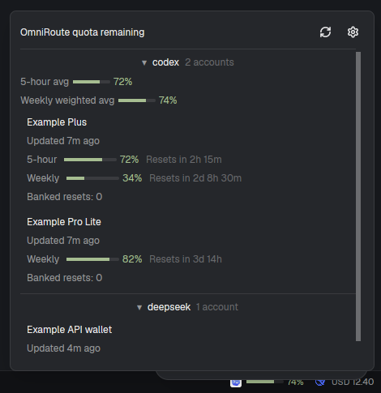

# Herdr OmniRoute Usage

See the remaining quota and reported wallet balances for your OmniRoute accounts in Herdr’s footer. Hover for account details, reset countdowns, and banked credits, or click to keep the popup open while you work through it.

## What you see

- At the right edge of a 28 px status row, draw a 26 px-high strip on the theme’s `chrome` background, with a 1 px top border. Right-align provider groups, allow horizontal scrolling, and use 11 px text. Each group shows a 14 px provider icon (or the provider name if no icon is bundled), then a 46 × 4 px quota bar and percentage, currency amounts, or an em dash. Quota fill uses theme green above 30%, amber at 11–30%, and red at 10% or less. Show “OmniRoute” only when the footer has no visible providers.
- Anchor a 450 px-wide, at most 460 px-high rounded popup above the footer’s right edge. Use the theme’s `popover` surface and 12 px text. Keep the title, refresh icon and settings cog above a vertically scrolling list. Each provider has a chevron and account count; collapsing it preserves its main quota percentage or balance. Expanded groups show account names, freshness, quota windows, reset times, wallet balances and any reported banked credits. Use muted text for dates and age and amber for fetch errors.
- Open settings in a 660 × 560 px dialog with a 120 px vertical tab rail. **Display** opens first with independent Footer and Popup switches per provider and the Codex window choice. **Date & Time** has countdown or timestamp modes and a format preview. **Connection** has the instance URL, a masked token, a redemption switch, and a connection test. Codex redemption uses a separate 430 × 205 px confirmation dialog identifying the account and credit expiry.

## How it behaves

- The mod tracks provider accounts, not Herdr agents: working, blocked, done and idle do not change its appearance. There are no custom shortcuts or keybindings.
- Hover for 350 ms to open; moving from footer to popup keeps it open. Leaving both starts a 300 ms close delay. Clicking anywhere in the footer opens and pins the same popup; an outside click dismisses it. The list scrolls independently of the header. Clicking a provider header toggles just that group. The cog opens settings.
- Load at startup, every five minutes, and when the refresh icon is pressed. Refresh reloads OmniRoute’s cache; it does not force provider sync. Show the age of the provider cache when known, distinguish missing quota from failed retrieval, and retain the last good reading on a failed refresh. Mark old or retained figures stale. Reset and expiry countdowns update locally while visible; elapsed times say “Reset due” or “Expired”, without inferring a new quota reading.
- Display and date choices save immediately. Connection settings save only after a successful test. Monitor with a read-scoped token by default; saving an enabled Codex redemption switch requires a write-scoped token. Redeem only after confirmation, for the displayed account and exact soonest-expiring eligible credit. Refresh the reading afterward; never automatically spend another credit after failure.

## Built from

- Put the standalone JavaScript mod at `mods/herdr-omniroute-usage/` with a `main.js` view, `mod.json` with `place: "none"`, and local modules for rendering, OmniRoute requests, time formatting and icon lookup. No runtime packages or subprocesses. Use Herdr’s existing personal status row beside `workspace-status`; a flexible block with weight `3.2` and minimum width `130` is a starting point, not a shipped layout. An optional `border: false` prop hides the footer’s top border.
- Use `gpui-kit` and `gpui-base`: a measured right-anchored `Popup`, a bounded `overflow_y_scroll` body with native `Scrollbar`, native buttons and switches, and retained masked `InputState` for the token. Use `theme`, `props`, `shared`, `setShared`, `openOverlay`, `closeOverlay` and `checking` from `herdr`. Overlay props identify settings or confirmation views; keep credentials out of props. Use `cx.spawn` for requests and view-owned timers for polling, hover delays and visible countdowns. Reuse Herdr’s shipped `frame/settings/refresh.svg` and `mods/workspace-chrome/settings.svg`, with bundled provider SVGs and notices for their sources.
- Send bearer-authenticated `GET /api/cli/whoami` to verify a scoped access token, `GET /api/providers` for configured connections, and `GET /api/usage/provider-limits` for per-connection quota and cache metadata. Join the cache to the inventory by connection ID. List credits for Codex, Claude and Grok CLI with `GET /api/usage/codex-reset-credit?connectionId=…`. The only mutation is the opt-in Codex redemption `POST /api/usage/codex-reset-credit`, with the connection ID, the exact credit selection token as `creditId` and a fresh idempotency key. Treat an unconfirmed result as uncertain rather than success. Keep safe error messages separate from data.
- Normalize remaining quota from the reported percentage or finite used/total counters. Treat unlimited `credits_<currency>` rows as wallet balances, not percentages; sum balances separately by currency. Use the lowest fully reported comparable quota-window summary for other providers. For Codex, default to the 5-hour summary and allow Weekly or Mixed; summarize only active reporting accounts. Weight Plus at 1× and Pro Lite at 5× for weekly only. Unknown weights remain visible individually, not in the totals. Mixed averages the two window summaries, not two allowances added together.

## Watch out

- Target Herdr desktop 0.1.18 and the OmniRoute 3.8.54 API contract. Require HTTPS for remote instances; allow plain HTTP only on loopback. Herdr’s shared settings store the bearer token unencrypted. Use a dedicated revocable token and keep settings, account identities and live data out of public screenshots and version control.
- OmniRoute’s normalized `total: 100` does not identify a Codex plan’s capacity. Do not guess weights or show an incomplete summary as a full pool. Wallet totals may double-count keys that share the same wallet.
- Keep the popup anchored to the constrained footer block, not the overflowing icon row. Track hover over the trigger and popup separately. Keep the provider list’s scroll viewport bounded and leave the header outside it. Avoid I/O during `herdr-app check`.

## Done when

- Herdr loads the mod without layout or key files from this package. A narrow footer keeps the indicators right-aligned and does not expose account names. An unconfigured footer still opens the popup and settings.
- Hover transfers into the popup without dismissal; click pins it, outside click closes it, and scrolling reaches the last provider. Collapsing a group leaves its summary visible.
- Fixture readings show a weighted Codex total, independent weekly and 5-hour countdowns, and a currency wallet balance. Missing quota is not shown as zero; stale and failed reads are distinguishable.
- Display and time preferences survive closing settings. A read token connects without redemption; a failed connection test leaves the saved connection intact. A fixture redemption request names the selected credit and does not retry automatically.
- The packaged tests and `herdr-app check` pass. Capture the preview in an isolated Herdr profile using synthetic accounts and quota data.
